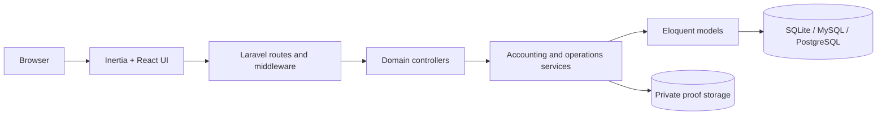

# Oggy Marble ERP

[](https://github.com/awanafnan17/Oggy-Marble-ERP/actions/workflows/ci.yml)


Oggy Marble ERP tracks a marble factory from raw-stone intake to the financial
ledger. It covers stone-to-slab and slab-to-tile production, batch inventory,
purchasing, sales, accounting, quality control, dispatch, and reporting.

This public edition is a **sanitized, source-available portfolio release**.
Production databases, credentials, transaction proofs, backups, staff records,
customer records, deployment files, and client-specific branding are not part of
the repository.

## How the workflow fits together

Oggy Marble ERP connects factory operations to accounting rather than treating
them as separate systems. A production run can consume inventory, record output,
calculate yield and variance, and feed the financial ledger. Closed accounting
periods protect historical records, while reversals preserve an audit trail.

### Core capabilities

| Area | What is implemented |
| --- | --- |
| Dashboard | Financial KPIs, cash position, inventory valuation, production metrics, sales trends, and receivable aging |
| Inventory | Products/SKUs, batches, warehouses, adjustments, physical reconciliation, transfers, valuation, and printable gate passes |
| Marble production | BOMs, production orders, stone-to-slab and slab-to-tile runs, schedules, machines, yield, wastage, and variance posting |
| Sales | Orders, customer invoices, payment allocation, printable invoices, and controlled void/reversal flows |
| Purchasing | Purchase orders, supplier bills, supplier payments, and payable tracking |
| Accounting | Double-entry journals, chart of accounts, period close/reopen, trial balance, P&L, balance sheet, and party ledgers |
| Cash and bank | Cash/bank accounts, transfers, proof images in private storage, bulk reconciliation through a statement date, and manual review |
| Operations | Delivery challans, dispatch tracking, quality inspections, machine rentals, daily reports, CSV exports, and audit logs |
| Administration | Role-based access, user activation controls, password management, database backup command, and import templates |

> The reconciliation bulk action is deliberately named for what it does: it
> marks pending transactions through the selected statement date. It is not a
> statement-line matching engine.

## Architecture



- Laravel owns authentication, authorization, validation, transactions, and
  domain rules.
- Inertia connects Laravel controllers to React pages without a separate REST
  application.
- Services encapsulate inventory, reconciliation, subledger, period, dashboard,
  and production-variance behavior.
- Transactional writes pass through permission checks and accounting-period
  locking.
- Database transactions, row locks, no-negative-stock checks, and reversal
  entries protect operational integrity.

Read [the architecture guide](docs/ARCHITECTURE.md) for the module boundaries,
posting rules, and data-flow details.

## Technology stack

- PHP 8.2 or 8.3, Laravel 12, Eloquent, PHPUnit
- Inertia Laravel 3, React 19, TypeScript 6
- Tailwind CSS 4, Vite 8, Recharts, Lucide
- SQLite for the fastest local demo; MySQL or PostgreSQL for a managed deployment
- GD with WebP support for private transaction-proof optimization

## Local demo

There is no hosted public ERP demo because a shared authenticated instance would
need persistent data and introduce privacy and abuse risks. The complete
application can be evaluated locally with synthetic data.

### Prerequisites

- PHP 8.2/8.3 with PDO SQLite, Mbstring, Fileinfo, GD, WebP, and EXIF support
- Composer 2
- Node.js 20.19+ and npm
- SQLite, MySQL, or PostgreSQL

### macOS / Linux

```bash
git clone https://github.com/awanafnan17/Oggy-Marble-ERP.git
cd Oggy-Marble-ERP
composer install
npm ci
cp .env.example .env
php artisan key:generate
touch database/database.sqlite
```

### Windows PowerShell

```powershell
git clone https://github.com/awanafnan17/Oggy-Marble-ERP.git
Set-Location Oggy-Marble-ERP
composer install
npm ci
Copy-Item .env.example .env
php artisan key:generate
New-Item database/database.sqlite -ItemType File -Force
```

Then, on either platform:

1. Open `.env` and set `OGGY_SUPERADMIN_PASSWORD` to a unique value of at least
   12 characters. Change `OGGY_SUPERADMIN_EMAIL` if desired.
2. Initialize the database and master records:

```bash
php artisan migrate
php artisan oggy:setup-master-data
```

3. Start the application:

```bash
composer dev
```

4. Open <http://127.0.0.1:8000> and sign in with the administrator email and
   password you configured.

The setup command is safe to rerun for roles, permissions, accounts, banks, and
warehouse reference data. It does not rotate an existing administrator's
password; use the authenticated security screen for password changes.

## Roles and permissions

The default role catalogue includes:

- Administrator: complete system control
- Owner: broad read access to KPIs, reports, and operations
- Accountant: accounting, reporting, sales, purchasing, and cash/bank work
- Inventory manager: stock, batches, warehouses, adjustments, and transfers
- Production manager: BOMs, production runs, schedules, machines, and variance
- Sales representative and purchase agent: scoped commercial workflows
- Quality inspector and dispatch clerk: scoped operational workflows
- Viewer: dashboard and report access only

Permissions are enforced server-side. Hiding a navigation item is a convenience,
not the security boundary.

## Useful commands

```bash
# Quality checks
composer audit --locked
npm audit --omit=dev
npm run typecheck
npm run build
php artisan test

# Master/reference data
php artisan oggy:setup-master-data
php artisan oggy:sync-pakistan-banks
php artisan oggy:audit-product-readiness

# Preview product-account mapping repairs without writing
php artisan oggy:repair-product-account-mappings --dry-run

# Generate synthetic CSV templates under ignored local storage
php artisan import:templates

# Create an ignored local SQLite backup
php artisan db:backup
```

## Configuration

| Variable | Purpose |
| --- | --- |
| `APP_ENV`, `APP_DEBUG`, `APP_URL` | Laravel runtime and public URL |
| `DB_*` | SQLite, MySQL, or PostgreSQL connection |
| `OGGY_SUPERADMIN_EMAIL` | First administrator identity |
| `OGGY_SUPERADMIN_PASSWORD` | Required only when the first administrator is created; never commit it |
| `COMPANY_*` | Invoice, challan, report, and ledger identity |
| `SESSION_DRIVER`, `CACHE_STORE`, `QUEUE_CONNECTION` | Runtime state and background-work strategy |
| `MAIL_*` | Notification transport |

`.env.example` contains placeholders only. The real `.env` is ignored.

## Testing and release checks

The test suite exercises core ERP posting, inventory, UI workflows, password and
role security, bank reference data, accounting readiness, real-user workflows,
physical-device UAT scenarios, and posted-entry reversals. GitHub Actions runs:

- manifest validation and PHP/JavaScript production dependency audits;
- frontend type checking and production build;
- the Laravel application test suite on SQLite in memory.

Secret scanning is performed before public releases. Dependency trees, build
output, databases, logs, uploads, backups, and local environment files are
excluded from source control.

## Production deployment

This repository still needs deployment hardening before real use. Configure
managed secrets, HTTPS, a production database, reliable backups, restricted
proxy settings, durable sessions, cache and queues, log retention, and an
independent application-security review.

See the [deployment checklist](docs/DEPLOYMENT.md) and [security policy](SECURITY.md).

## Repository status and licensing

The public edition includes the application architecture and major workflows.
Real business data and deployment-specific material were intentionally removed.

Copyright © 2026 Afnan Mehmood Awan. This is a source-available portfolio
release, not an open-source grant. See [LICENSE](LICENSE).
